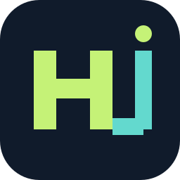

# Cerebra

**The AI engineering brain.** A Windows desktop app where real AI coding agents (Claude and ChatGPT/Codex) plan, build, test and review software for you, under a supervisor you control.

- **Real agents, your accounts.** OpenAI Codex and Anthropic Claude Code plan, write and review code using your own ChatGPT/Claude sign-in. There are no API keys to paste and no demo mode.
- **A supervisor, not a chatbot.** A deterministic Python supervisor gives each task to a planner, a coder and an *independent* reviewer from a different provider. It runs your project's real tests itself and repairs failures up to three times.
- **You approve every step.** The plan, letting agents run, and merging the result each need your yes. Code is written in an isolated Git worktree; your project changes only when you approve the merge.
- **See inside.** The *System view* is a live map of the backend: web server, supervisor, AI roles, working copy, test runner, approval gate, database and logs, lighting up as work flows through them.
- **Explained simply.** Every task gets a plain-language *Report* that anyone can read: what was asked, who did what, whether the tests passed, and where everything is saved.
- **Business Studio**: paste a client brief and get original, checked and independently reviewed deliverables (website, listing copy, SVG design, document) exported to a folder on your laptop with a README, manifest and review findings.
- **Support chat** that knows every project and task: ask "why did EstatePilot fail?", paste a client's request to have it understood and planned, or say "build this". It proposes or, if you let it, creates and starts the projects and tasks itself.
- **The right model for each job.** Pick models yourself (Claude Opus 5.5, Sonnet 5.5, Haiku 5.5; GPT-6-Astra, GPT-6.1-Sol, GPT-6-Luna and whatever else your Codex plan lists), or leave a role on **Auto**. The supervisor then rates each task and gives hard work to frontier models and small jobs to fast ones. It can also ask a *supervisor model* to choose, and checks its answer before using it.
- **Away mode**: Cerebra keeps working while you're away. It approves plans and runs for you for a set time, and can optionally merge and push work that passes every test and review.
- **Full access (opt-in)**: let the coding agents run any command on your laptop and use your GitHub login.
- **Models & sign-in**: sign in and out from the dashboard, and save your own model profiles.
- **GitHub**: connect your account, clone repositories, publish and push.
- **Toolchain**: check and install Git, Node.js, Python, .NET, Java, Go, Rust, Docker, VS Code and the AI CLIs in one place.

Everything except AI inference runs on `127.0.0.1`. Data stays in a local SQLite database.

## Install (Windows 10/11 x64)

Run `Cerebra-Setup-<version>-Windows-x64.exe`. Setup installs for your account only, without administrator rights. It bundles its own Python runtime, needs Microsoft Edge WebView2 (preinstalled on Windows 11), and opens Cerebra in its own window. See [docs/WINDOWS_INSTALLER.md](docs/WINDOWS_INSTALLER.md).

Then follow the *Get started* checklist on the Overview page, or read [docs/USER_GUIDE.md](docs/USER_GUIDE.md).

## Run from source

```powershell
.\scripts\setup.ps1          # creates .venv from requirements.lock
.\scripts\start.ps1          # opens the dashboard with a private one-time session link
.\scripts\stop.ps1
```

Python 3.13+ and Git are required.

## Build the installer

```powershell
.\.venv\Scripts\python.exe scripts\build_windows.py --output dist
.\.venv\Scripts\python.exe scripts\test_windows_installer.py dist\Cerebra-Setup-<version>-Windows-x64.exe --test-root <empty folder>
```

The builder uses the project's Python environment and the Windows .NET Framework C# compiler, and downloads nothing. The installer is unsigned until you add a code-signing certificate.

## Tests

```powershell
.\.venv\Scripts\python.exe -m pytest -q
```

Tests never launch a real AI CLI. They use the fixture agent in `tests/fakes.py`. The dashboard has a headless Edge test in `scripts/test_dashboard.cjs`.

## Documentation

- [User guide](docs/USER_GUIDE.md): setup, tasks, chat, models, GitHub, and where results are saved
- [Security boundaries](docs/SECURITY.md)
- [Architecture](docs/ARCHITECTURE.md)
- [Windows installer](docs/WINDOWS_INSTALLER.md)
- [Development](docs/DEVELOPMENT.md)
- [Progress record](docs/progress.md)

## License

Proprietary. All rights reserved. See [LICENSE](LICENSE).
